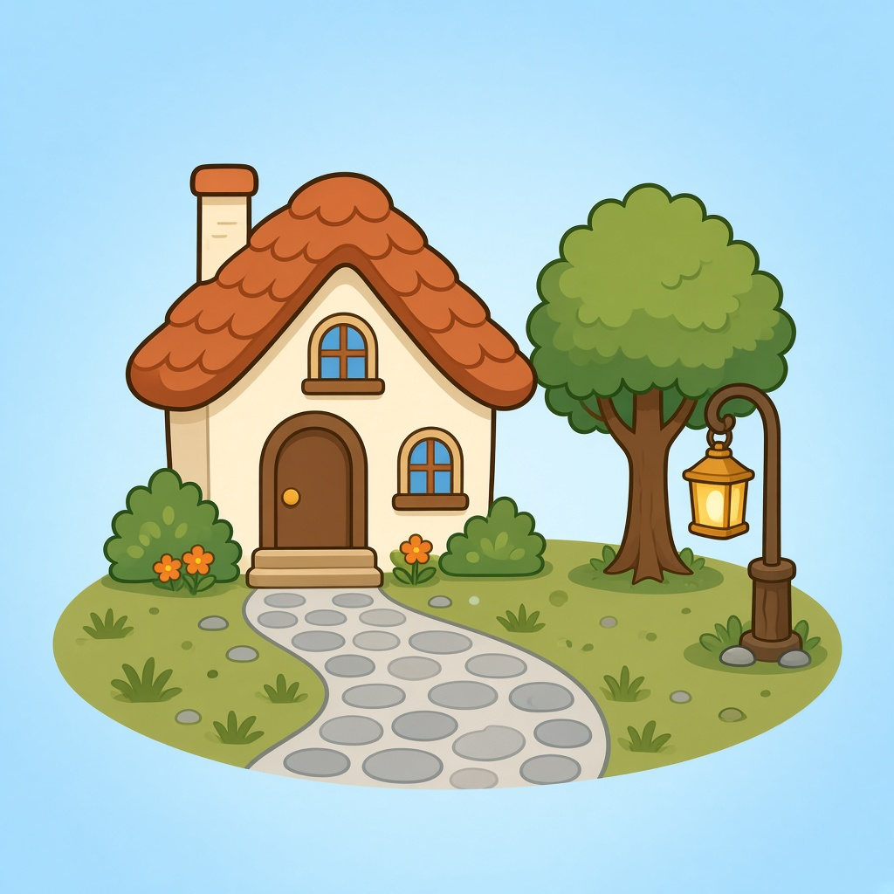
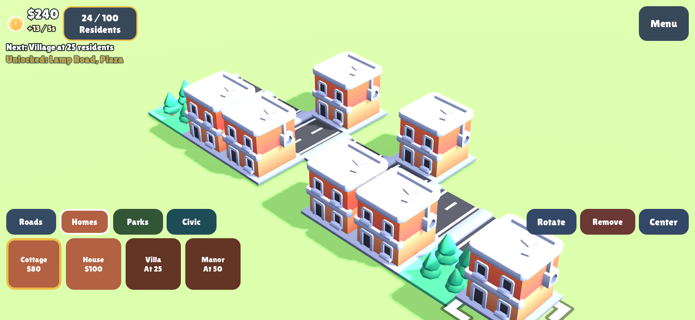

# Cobblewick

A small landscape city builder for phones, built on the Kenney Starter Kit City Builder for Godot 4.6. Lay roads, house neighbors, and grow Cobblewick to a chartered town of 100 residents.

Bundle id: `es.verkvest.cobblewick`

### Play

- **Title menu** — continue a saved town, start a new one, read how to play, or open credits.
- **Touch** — tap to place or remove, drag with one finger to pan, pinch to zoom, twist with two fingers to rotate the camera. The build palette uses large buttons. Rotate a piece with the Rotate button or by tapping the same piece again.
- **Desktop** — WASD pans, the scroll wheel zooms, the middle mouse button orbits, left click places, right click rotates the piece, Delete removes, F recenters.
- **Goal** — homes count residents only when they sit beside a road. Income arrives every five seconds. Crossing 10, 25, 50, and 100 residents pays a bonus and unlocks bigger buildings. The charter at 100 is the win; the town stays playable after that.
- **Save** — the town autosaves to `user://map.res`. Sound and the first-run hint live in `user://profile.cfg`.

### Screenshot

### Adding buildings

Duplicate a resource in `structures/`, set its model and gameplay fields (name, category, price, residents, unlock), then add it to the Builder node's Structures array. Keep existing entries in order: saved towns store mesh-library item ids.

### License

Game code is MIT. Kenney models, sprites, and sounds are CC0. The Lilita One font is OFL 1.1 (reserved name Lilita). The audio pool is adapted from KidsCanCode under MIT. Godot Engine is MIT. Full notices are in `THIRD_PARTY_LICENSES.md` and on the in-game Credits screen.

MIT License

Copyright (c) 2026 Kenney

Permission is hereby granted, free of charge, to any person obtaining a copy of this software and associated documentation files (the "Software"), to deal in the Software without restriction, including without limitation the rights to use, copy, modify, merge, publish, distribute, sublicense, and/or sell copies of the Software, and to permit persons to whom the Software is furnished to do so, subject to the following conditions:

The above copyright notice and this permission notice shall be included in all copies or substantial portions of the Software.

THE SOFTWARE IS PROVIDED "AS IS", WITHOUT WARRANTY OF ANY KIND, EXPRESS OR IMPLIED, INCLUDING BUT NOT LIMITED TO THE WARRANTIES OF MERCHANTABILITY, FITNESS FOR A PARTICULAR PURPOSE AND NONINFRINGEMENT. IN NO EVENT SHALL THE AUTHORS OR COPYRIGHT HOLDERS BE LIABLE FOR ANY CLAIM, DAMAGES OR OTHER LIABILITY, WHETHER IN AN ACTION OF CONTRACT, TORT OR OTHERWISE, ARISING FROM, OUT OF OR IN CONNECTION WITH THE SOFTWARE OR THE USE OR OTHER DEALINGS IN THE SOFTWARE.

Assets included in this package (2D sprites, 3D models and sound effects) are [CC0 licensed](https://creativecommons.org/publicdomain/zero/1.0/)
